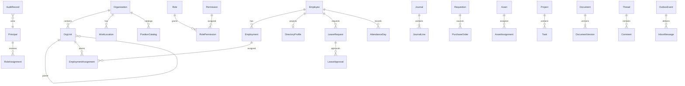

# ERD Global dan Ownership

| Context | Canonical owner | Cross-context references |
|---|---|---|
| Organization | Organization, OrgUnit, Location, PositionCatalog | opaque employee/principal IDs |
| IAM | Principal, Role, Permission, grants, policy | org scope/employee IDs |
| Employee | Employee, Employment, Assignment, private HR data | org/location/position IDs |
| Directory | rebuildable visible profile projection | employee ID + source version |
| Attendance/Leave/Payroll/Performance | domain records and history | employee IDs |
| Finance/Accounting/Procurement/Asset | respective accounting/ops data | employee/org IDs, events |
| CRM/Project/Documents/Collaboration | own aggregates and membership | principal/employee IDs, opaque target refs |
| Platform | Audit, Outbox, Inbox, telemetry config | opaque references, redacted metadata |

PK UUID. FK/query tidak lintas domain walau awal memakai satu Neon DB; akses lewat application API/projection. Cross-service reference diverifikasi pemilik. Projections rebuildable; histories append-only/compensating updates. Tidak cascade-delete employee/org history.
