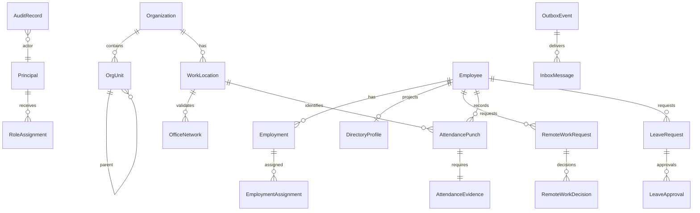

# ERD Global dan Ownership

## Attendance logical entities
- WorkLocation(id, org_id, name, address_label, kecamatan_code, latitude, longitude, timezone, geofence_radius_m, active). Kecamatan/work location disetel sebagai master demo; jangan geocode/IP lookup otomatis.
- OfficeNetwork(id, work_location_id, cidr, label, active, valid_from, valid_to). CIDR hanya egress IP publik kantor; unique/conflict checks dan audit perubahan. Jangan simpan data router rahasia.
- RemoteWorkRequest(id, employee_id, mode WFH|WFA, from_date, to_date, requested_area_label, reason, status, submitted_at, version). Alasan wajib dan tidak boleh disimpan di log.
- RemoteWorkDecision(id, request_id, manager_id, decision, reason, decided_at). Decision reason wajib, approver berbeda dari requester, manager scope enforced.
- AttendancePunch(id, employee_id, kind CHECK_IN|CHECK_OUT, occurred_at, business_date, timezone, work_mode WFO|WFH|WFA, source WEB, work_location_id nullable, remote_request_id nullable, office_network_id nullable, network_match boolean, latitude/longitude, accuracy_m, location_captured_at, idempotency_key, status, version). Hindari menyimpan raw client-supplied IP bila tidak diperlukan; simpan network match/config reference dan audit metadata minimal.
- AttendanceEvidence(id, punch_id unique, storage_bucket, object_key unique, mime_type, size_bytes, checksum, upload_status, captured_at, uploaded_at, verified_at, retention_until). Private bucket; signed URL bukan disimpan. Constraint ukuran/format/status dan relasi ke upload intent.

## Ownership dan integritas
Organization owns WorkLocation/OfficeNetwork configuration. Employee owns employment identity. Attendance owns remote requests, decisions, punches, upload intents and attendance history. IAM owns principal/grants. Audit platform owns redacted audit trail. Domain references lintas context memakai opaque UUID, tanpa FK/query lintas konteks.

## Invariants
WFO must match active office CIDR to active WorkLocation; remote must reference approved request covering local business date; punch requires verified evidence and location capture. Unique employee+business_date+kind (atau state machine constraint yang eksplisit) prevents duplicates; CHECK_OUT requires valid prior CHECK_IN. Use transaction/locking to prevent races. No cascade-delete history; correction is append-only adjustment.
